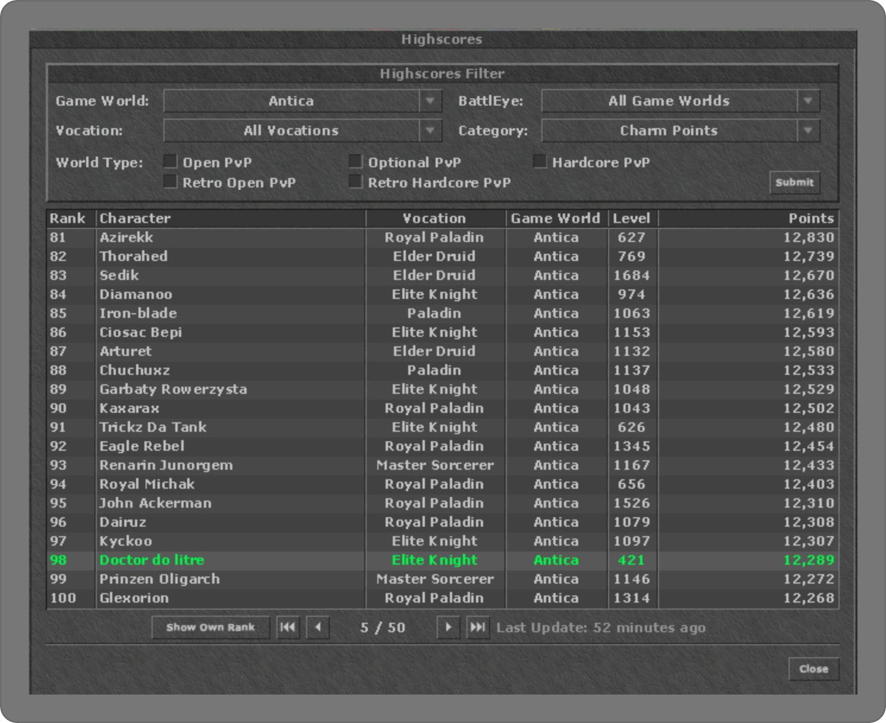
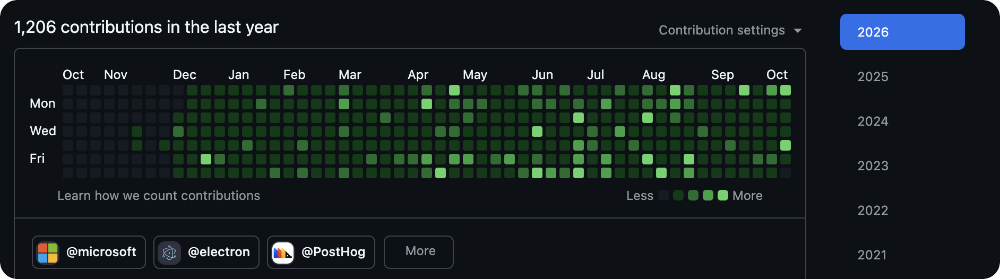
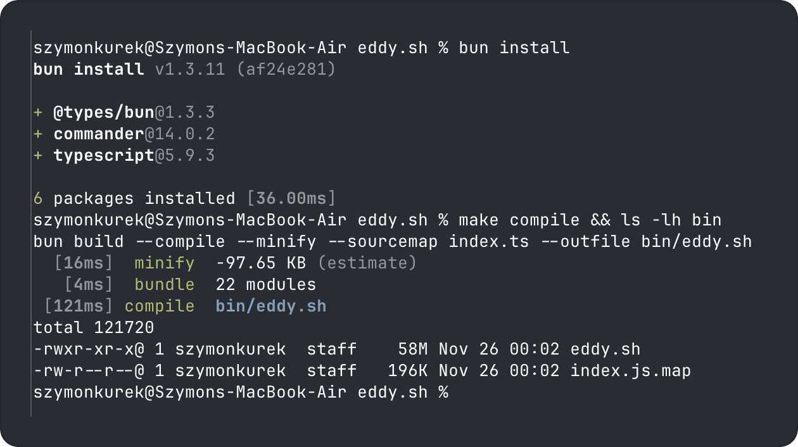
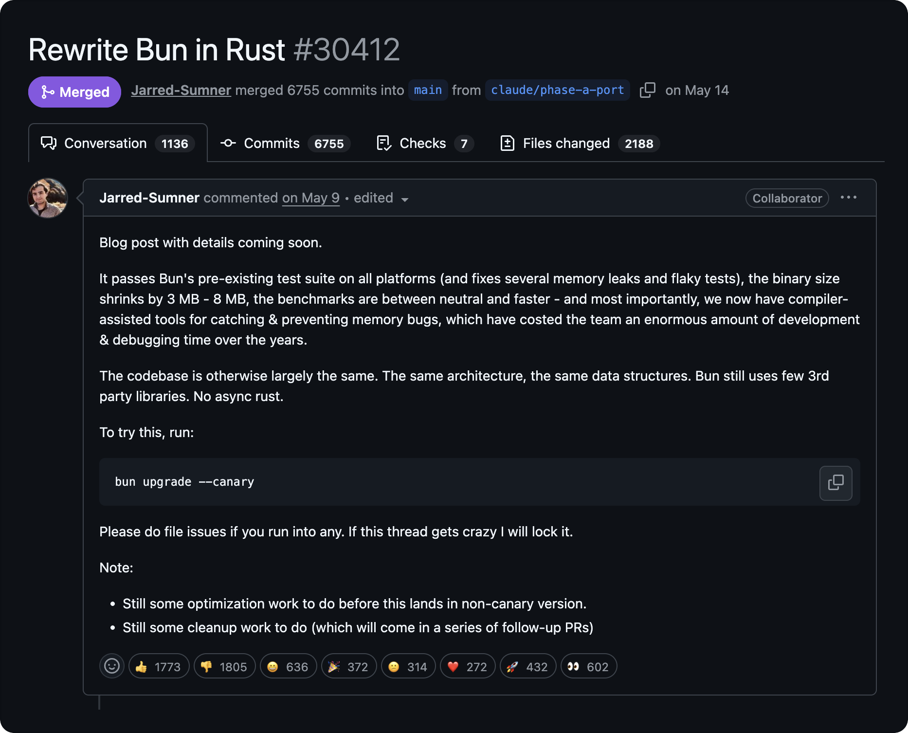
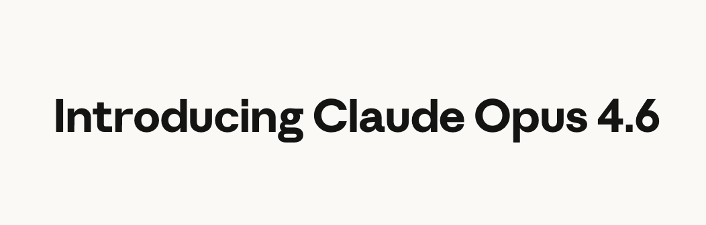

Last year I was playing one of my favorite games a little bit too much.

It's an MMORPG, so you can basically do whatever you want. Powerlevel, explore the lore, dig into some secrets and unsolved mysteries (highly recommend some you could find on fanpages, like [469 by Antonio Stradivarius](https://tibiasecrets.com/article160), or [Serpentine Tower by Meadek](https://tibiasecrets.com/article141)) - for me the most interesting thing was completing a bestiary.

Bestiary is not something unique to this game, and for those who don't know it's basically an encyclopedia in which you unlock entries by repeatedly killing a monster. Every monster has 3 stages, and depending on the difficulty, you'd need to kill between 25 and 5000 creatures of the same type. Seems boring, but I found it somewhat fascinating.

Every day before work, I found myself playing this game just to progress with the bestiary. When I got to top 100, I had already unlocked all the harmless, trivial and easy monsters, so each entry started to be more tedious and time consuming.

I thought to myself that if I spent this hour focusing on programming related activities I would be even better than I was. And so I decided that before playing a game I would make at least one commit.

Rules are simple:

- it doesn't have to be big,
- it just has to make me sit down and think about what I want to do

It can be anything: a project change, some API / programming language I want to try, writing a blog post, or reading something interesting that I want to save somewhere I can find (because my notetaking is really shitty).

## December and January

I started 8th of December 2025, and on 1st of January I created [365](https://github.com/kurekszymon/365). A repo I've committed to every day since. And oh boy, was it worth it.

At first it didn't look like much. I wanted to give Bun a try, because of their [single-file executable](https://bun.com/docs/compiler/executables). I have a weird love for the single file entry, and it felt like _57MB Hello World_ magic. Started to port my existing project I'd built in C++, then rebuilt in Go, to TypeScript.

I would drop Bun after [their agentic migration to Rust](https://bun.com/blog/bun-in-rust) later in 2026, but that's beside the point.

I realized that everything feels like magic if you don't understand it enough. I thought that the engineer that designed the system I worked on through 2025 was a genius, I couldn't understand how they got a C++ WASM app to communicate over something called `InterTabCommunication` between two instances of the app. I imagined some super complex, custom written C++ protocol to solve this unimaginably hard (for me) problem.

And when you are working to make your target platform better and within deadlines, there is a tradeoff between understanding and delivery, so I didn't have the time to properly investigate it on my own.

Then at the end of the year, I needed to make some changes to a WebRTC + Java Backend project and stumbled upon this sprinkle of magic, which is [BroadcastChannel](https://developer.mozilla.org/en-US/docs/Web/API/BroadcastChannel).

The whole year I thought I was just following some genius's footsteps and then poof - it's just a builtin Web API. I felt so dumb and so empowered at the same time. You don't need a genius. You need someone who knows what to look for. _Even if it's something obscure_.

<!--  -->

And so I started to dig into Web APIs:

- BroadcastChannel
- WebRTC
- WebGL
- Canvas
- OffscreenCanvas
- localStorage
- IndexedDB
- etc.

...and also to better align with my work profile

- C++ and emscripten

Work projects change, and once again I was left without a reason to study for work.

But hey, besides all that I was able to score my first OSS contributions to [electron/electron](https://github.com/electron/electron/commit/24526ccd390664a005a93dd464cc774e6a868977) and [electron/packager](https://github.com/electron/packager/commit/13d93d35415b37045121fb42cd15a75d23e60a68), giving it a go to better understand so-called InterProcessCommunication and stuff around desktop apps and webviews. I think it's cool.

## February - March

I spent my time checking out Rust: reading [the Rust Book](https://doc.rust-lang.org/book/), doing rustlings, trying out code editors since I was annoyed with VS Code and even trying to write my own in Rust!

Not because I'm good enough to write my own editor, but because it was right around the [Opus 4.6 release](https://www.anthropic.com/news/claude-opus-4-6).

I remember sitting on the train to Warsaw for the WarsawJS conference, with [Zed](https://zed.dev) open and just being amazed by how good this model was. At the same time I was vibing my code editor, creating _this page_ (still manually, with Astro, since my attention span back then limited me to only one agent) and writing my first blog post [git got good](/01-git-got-good).

I was comparing Rust to C++ I worked with in 2025, learned some new data structures, and even made a working ~~code~~ text editor.

That's when I decided to put real time into learning to work with agents. Until then I was either too ignorant, or the models weren't good enough, to even consider it.

_Opus 4.6 changed me, for sure_.

As a sidenote, after trying multiple code editors, like aforementioned Zed, Neovim or Cursor, I decided to finally stick with VSCode. I'm really proficient with it, and spending time to learn different editors felt like a waste of time, especially since all of them are similar but very different. I will probably write a post about it in the future, and if I do I'll link it here.

In March I also tried diving more into backend, trying to reproduce PostHog's session replays with rrweb and Fastify. Touched some Java and PHP and since we started to plan the wedding, and my spatial imagination is worse than a 7-year-old's - I started to write easywed. and that's what taught me the most this year.

## April - October (being the product owner?)
