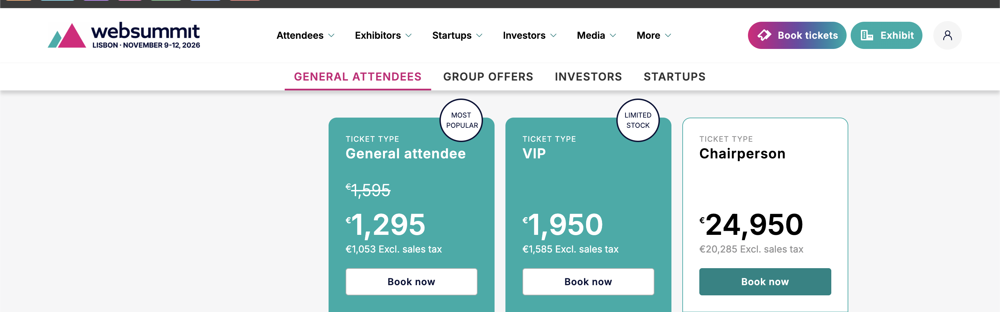
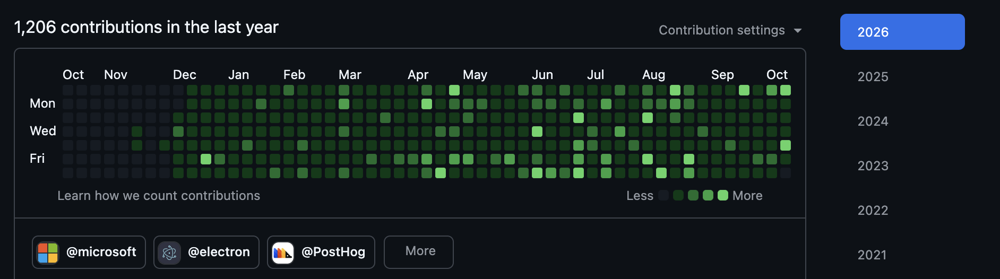
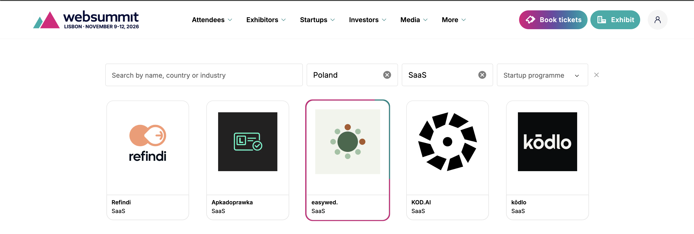

Web Summit Lisbon is a thing - a pretty big one. Since I changed projects and started working with Portuguese people I wanted to go to Portugal to meet them. My company wouldn't pay, and paying just to go to the office in a foreign country seemed to be a little too.. weird.

When I found out about Web Summit in Lisbon, it felt like I'd hit a bullseye - great opportunity for me to have a _business justification_ to go to Portugal and meet my colleagues in the office, great!

It was not so great when I visited _Book tickets_ page - 900€ (1295€ as of writing this post)?!

I was talking about it with my team lead, and he told me about [the developer program](https://websummit.com/developers) where you can join the conference for free if you have some open-source contributions, or based on the info from the website:

> Our AI system will review each applicant’s contribution, giving priority to frequent contributors to high-impact, open-source projects.

At the time I was able to merge my changes to `electron/packager`, smaller PRs in `cypress` and even some docs in `TanStack`, `PostHog`, `electron` or `OCaml.org` - seems like an easy way to get in, huh.

Except, you need to actually remember to apply when the time window opens, which is hard when you don't use calendars, so I missed the deadline. Bummer, I know.

Next thing I know is I'm browsing instagram stories and seeing an ad to apply for a startup program. So I did. Filled in the details, got a call on Monday, and.. `easywed.` will have a booth at Web Summit Lisbon, where my wife and I will be talking about it with anyone interested (or not, I am hyped enough to nag people anyway).

**_here's my tech bro starter pack (as an unexpected startup owner):_**

- I've updated my LinkedIn headline to `szymon@easywed.app`,
- 9-12 November I will be in Lisbon talking about the wedding planner I've developed,
- Applied for a PostHog Startup Program **and** got accepted ($50k in credits already granted, still waiting for my merch though...),
- CTOs from tech companies asking me if I want to join their initiative (I really appreciate it Albert, don't get the wrong picture!),
- Programming a lot, trying to understand all this marketing related stuff posting to Instagram, LinkedIn, and TikTok and having fun all in all.

Highly recommend having a product you can be hyped about that can _really_ help people or businesses with their needs or struggles.

If you plan a wedding or have a hall you organize weddings in - [try easywed.app](https://easywed.app) or [shoot me an email](mailto:szymon@easywed.app).
